

  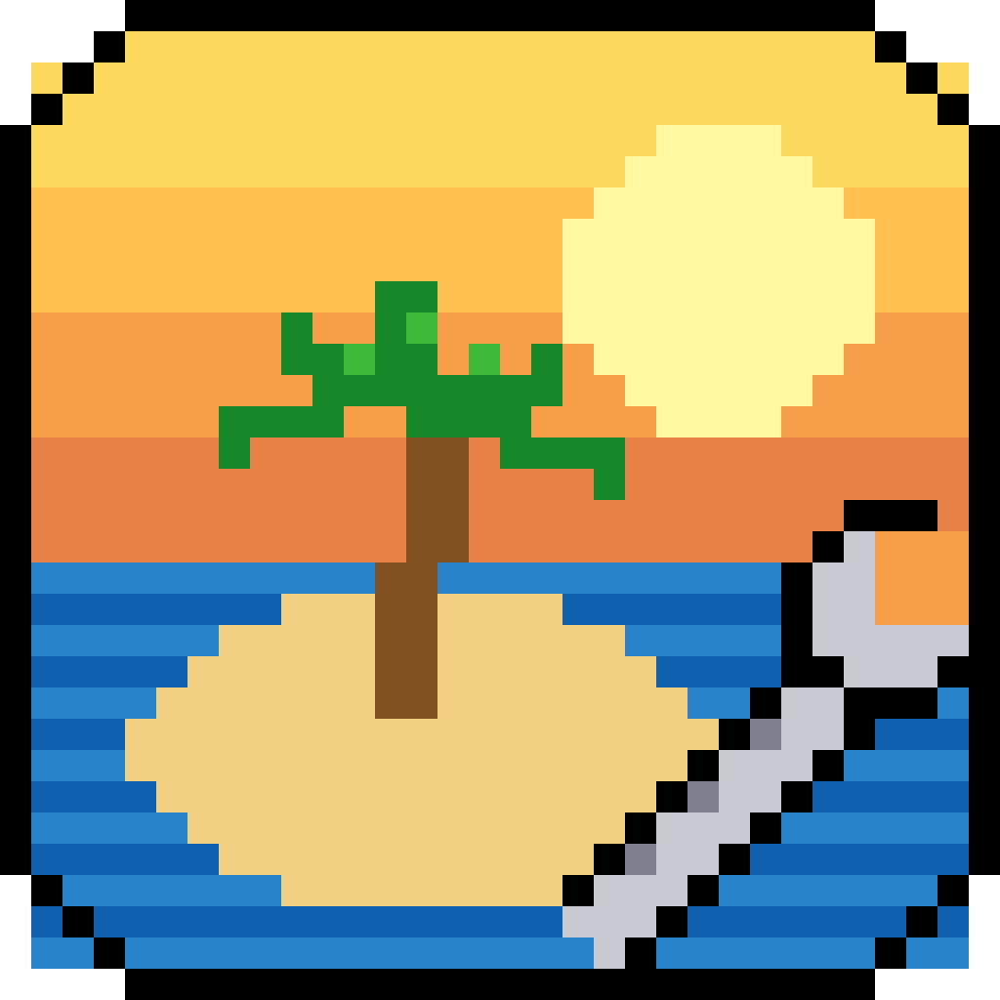

<h1 align="center">Horké léto Remastered</h1>

  <b>Play the 1998 Czech adventure Horké léto on a modern Mac or Windows PC, sharp at 1920x1440, with redrawn scenes.</b> 
  Free and open source. Bring your own original CD.

  <a href="https://github.com/007hacky007/horke-leto-remastered/releases/latest"><b>Download the latest version</b></a>
  &nbsp;·&nbsp;
  <a href="#getting-started">Getting started</a>
  &nbsp;·&nbsp;
  <a href="#what-you-need">What you need</a>
  &nbsp;·&nbsp;
  <a href="#questions">Questions</a>
  &nbsp;·&nbsp;
  <a href="#česky">Česky</a>

  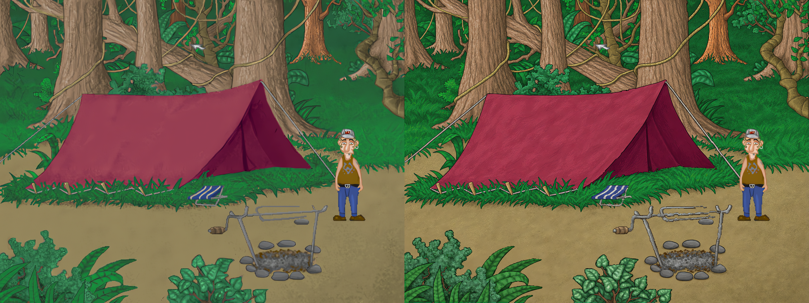
   Same scene, same moment. Original on the left, Remastered on the right.

> [!IMPORTANT]
> The game itself is not included. You need your own original Horké léto CD, or a
> backup image you made of it. The builder turns it into a version that runs on
> today's computers.

## What it is

Horké léto was made for DOS and Windows 95, at 640x480 with 256 colours. This
project is a new engine that runs the original game natively on Macs with Apple
silicon and on Windows 10 and 11, plus a builder that prepares the pictures:

- **Original**: every picture and animation of the game, enlarged three times by
  an AI upscaler (Real-ESRGAN) on your own computer. It looks like the game you
  remember, only sharper.
- **Remastered**: 316 scenes redrawn in more detail, together with colour-matched
  upscaled animations.
- **Press F8** at any time to switch between the two. Only the pictures change,
  your game stays where it is.
- **Hold Space** to show every spot you can click in the current scene. Handy
  when you have been staring at the same beach for ten minutes.
- The music from the CD and all the Czech voices are kept.

| At the tent | On the beach |
| --- | --- |
|  | 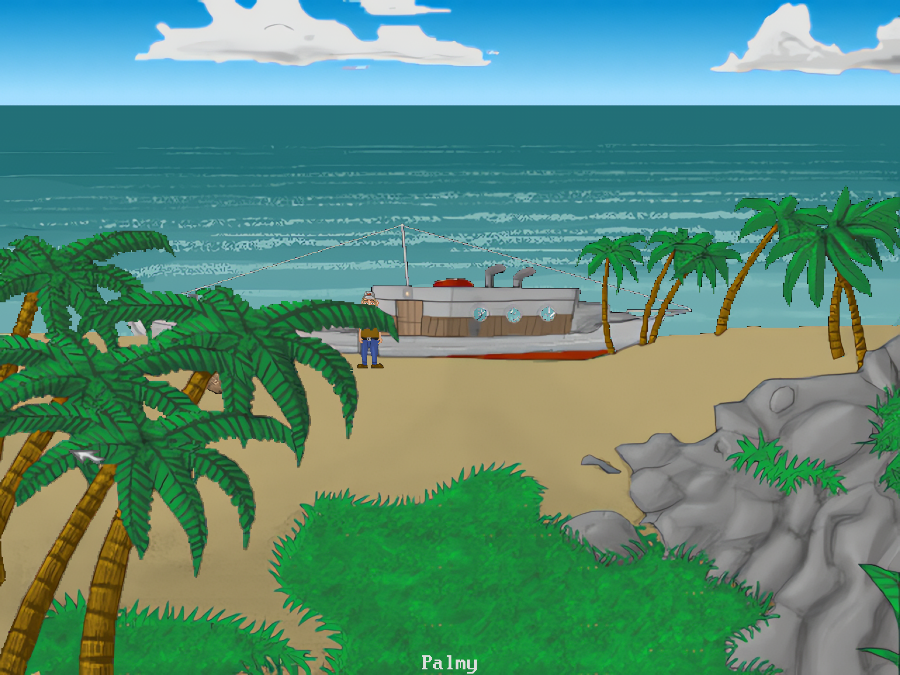 |
| **Inside the hut** | **Back at the boat** |
| 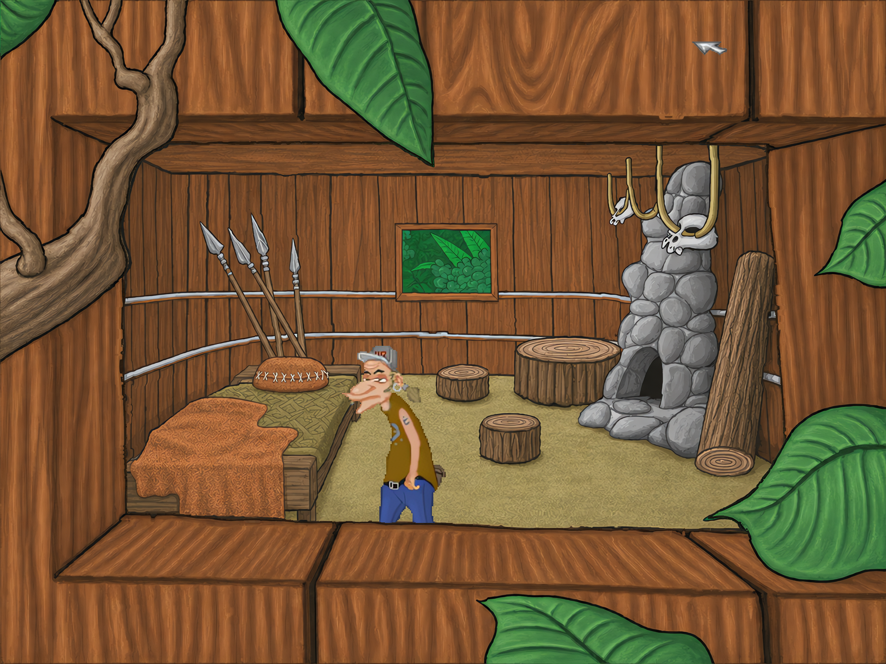 | 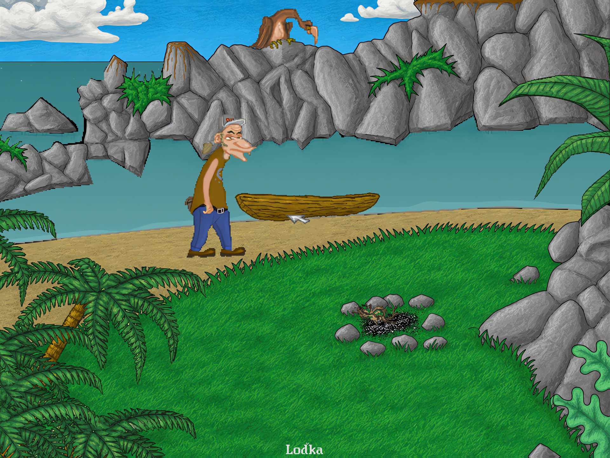 |

Hold **Space** for hints:

  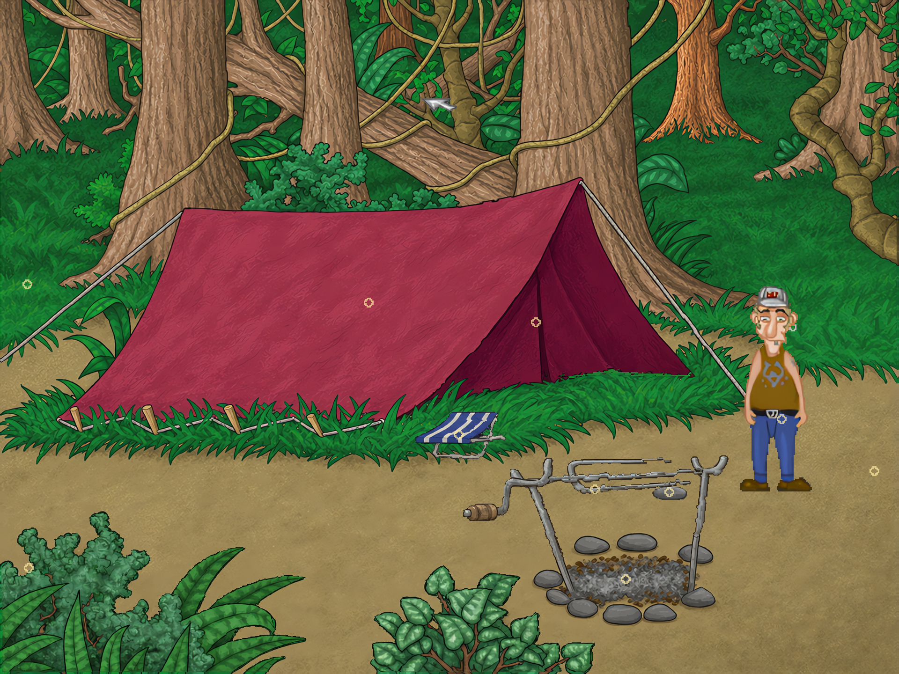

## Getting started

1. **Download the builder** for your computer from the
   [latest release](https://github.com/007hacky007/horke-leto-remastered/releases/latest):
   - Mac: `Horke-Leto-Builder-macOS.dmg`
   - Windows: `Horke-Leto-Builder-Windows.exe`
2. **Open it.**
   - **Mac:** open the disk image and double-click *Horke Leto Builder*. It is not
     signed by Apple, so the first time macOS refuses to open it. The disk image
     window shows what to do: click *Done*, open *System Settings > Privacy &
     Security*, scroll down and click *Open Anyway*.
   - **Windows:** if SmartScreen says "Windows protected your PC", click
     *More info* and then *Run anyway*.
3. **Choose your CD.** Pick a backup image of the disc (BIN/CUE, IMG/CCD, MDF/MDS
   or NRG; the builder recognises the format by itself). On Windows you can also
   put the CD in the drive and pick the drive letter.
4. **Let it check everything.** The builder looks at your disc, free space,
   graphics and internet connection, and tells you in plain words if something
   is missing.
5. **Wait.** Building takes about an hour and a quarter on an M1 Pro, longer with
   a slower graphics card. Meanwhile the game's own characters carry, unlock and
   hammer the pictures into shape. You can close the window at any time; next
   time it continues where it stopped.
6. **Play.** You get *Horke Leto.app* on a Mac, or a *HorkeLeto* folder with
   *HorkeLeto.exe* on Windows, with an icon made from your game files. Playing
   needs no internet connection.

<table>
  <tr>
    <td width="50%" valign="top">
      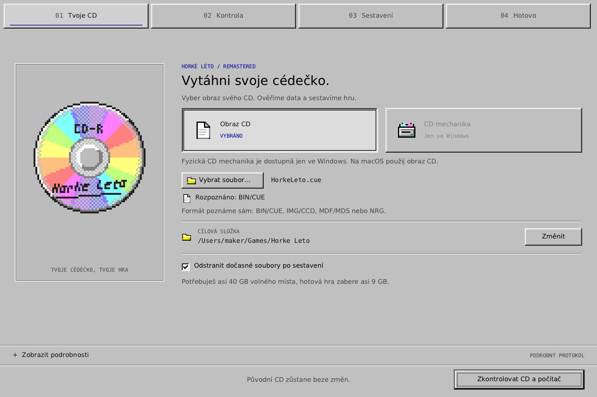 
      <b>Choose your CD.</b> An image file or, on Windows, the CD drive. Your
      original stays untouched.
    </td>
    <td width="50%" valign="top">
      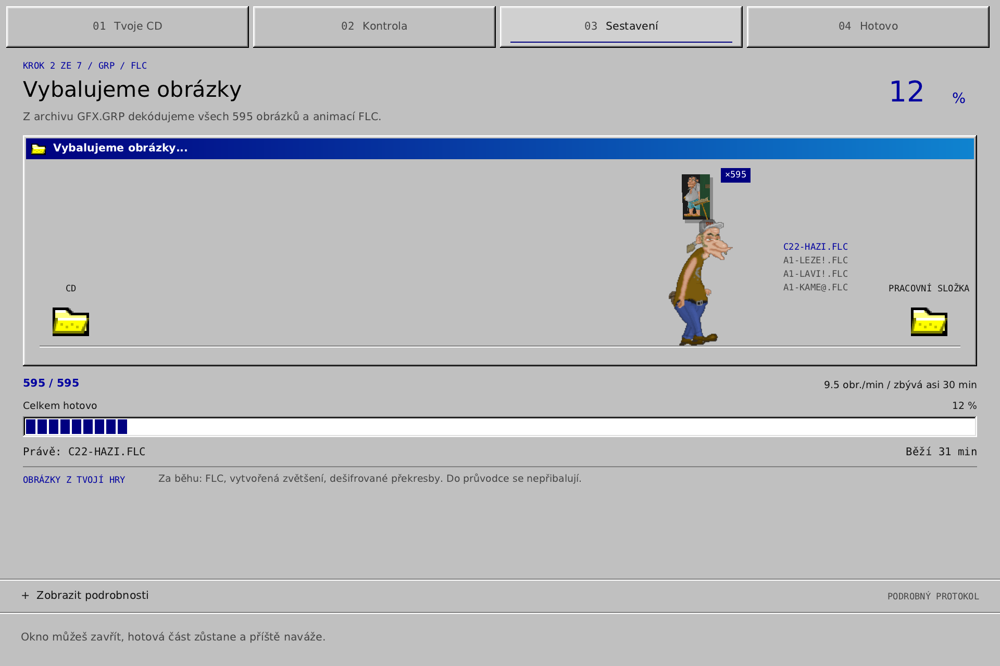 
      <b>Unpacking.</b> All 595 pictures and animations come out of the game's
      archive.
    </td>
  </tr>
  <tr>
    <td width="50%" valign="top">
      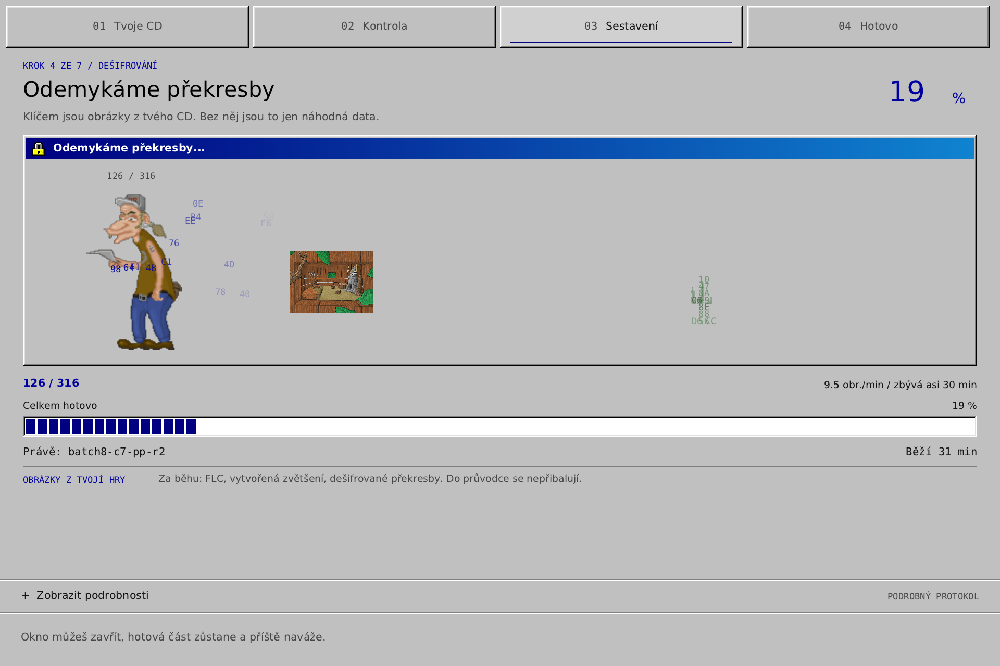 
      <b>Unlocking the redraws.</b> The new art is locked with your own CD, so
      only someone with the game can open it.
    </td>
    <td width="50%" valign="top">
      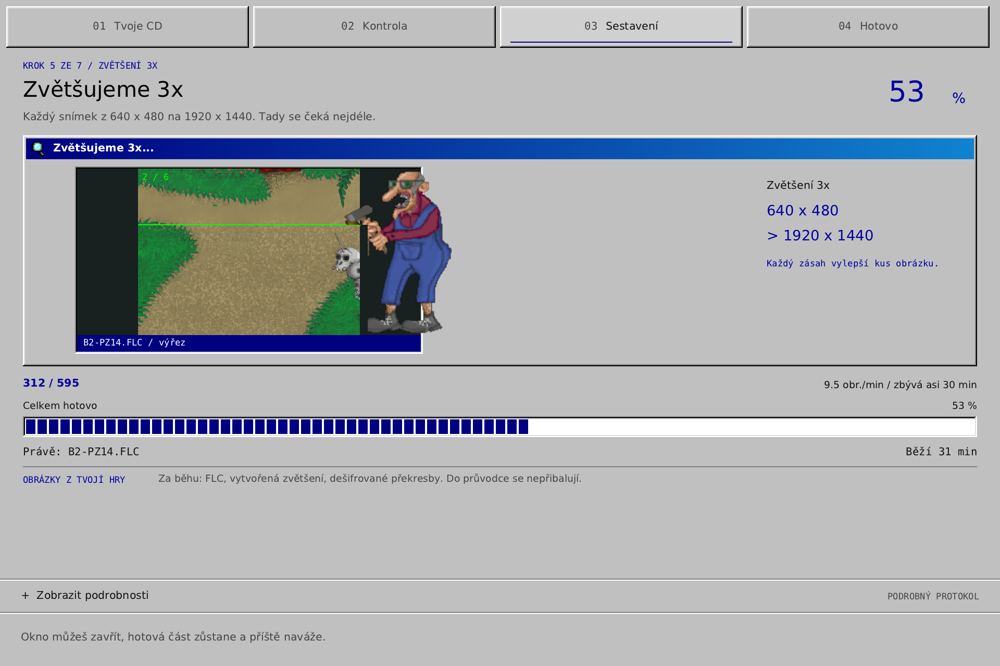 
      <b>Upscaling.</b> Every frame from 640x480 to 1920x1440. This is the long
      part, so the mechanic keeps you company.
    </td>
  </tr>
  <tr>
    <td width="50%" valign="top">
      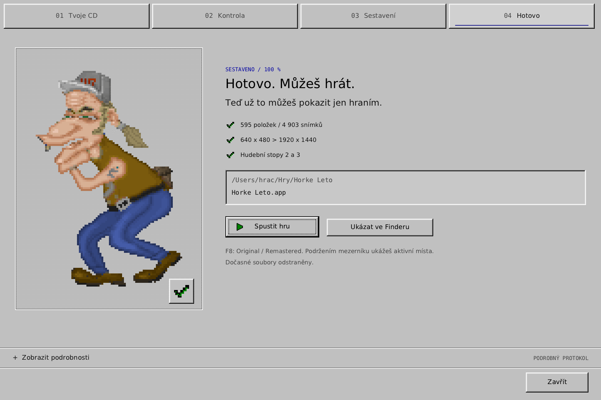 
      <b>Done.</b> "Teď už to můžeš pokazit jen hraním." Start the game straight
      from the builder.
    </td>
    <td width="50%" valign="top">
      <b>Something went wrong?</b> Click <i>Zobrazit podrobnosti</i> at the bottom
      of the builder for the full log, copy it and paste it into a new
      <a href="https://github.com/007hacky007/horke-leto-remastered/issues">issue</a>.
    </td>
  </tr>
</table>

The builder speaks Czech, like the game.

## What you need

| | Mac | Windows |
| --- | --- | --- |
| System | macOS 13 or newer, Apple silicon (M1 or later) | Windows 10 or 11, 64-bit |
| Graphics for building | Built in, nothing to install | A graphics card with an up-to-date driver (Vulkan) |
| Free disk space | About 40 GB while building, 9 GB for the finished game | Same |
| Time | About 75 minutes on an M1 Pro | 1 to 2 hours, depending on the graphics card |
| Internet | Once, to download the redrawn art (about 400 MB) | Same |

**Your CD.** The builder recognises the original Czech CD release of Horké léto by
its game files. It needs the complete disc including the music tracks, either as
an image or in the drive. A plain ISO file is not enough because it has no music;
make a BIN/CUE image instead.

Playing the finished game needs neither a graphics card nor internet.

## Questions

**Is the game included?** No. Nothing from the original game is in the builder or
in this repository. The builder reads it from your CD, on your computer.

**Why is the new art locked?** The redrawn pictures live in a
[separate repository](https://github.com/007hacky007/horke-leto-remastered-art),
encrypted. The key to each picture is the original picture on your CD, so the
redraws are useless to anyone without the game.

**Can I switch back to the original look?** Yes, press **F8** while playing.

**Where are my saved games?** On a Mac in
`~/Library/Application Support/hl-port/HorkeLeto`, on Windows in
`%APPDATA%\hl-port\HorkeLeto`. Removing the game does not remove them.

**It says my CD is the wrong release.** Only the release we could test is
supported so far. If you have a different one, open an issue with the log from
*Zobrazit podrobnosti* and we will try to add it.

**Building stopped halfway.** Start the builder again and choose the same target
folder. Finished parts are kept and checked, and it carries on from there.

**Can I copy the finished game to another computer?** Yes, for yourself. Please do
not upload it anywhere: it contains the original game.

## Česky

Horké léto Remastered je nový engine pro českou adventuru Horké léto (1998). Hra
díky němu běží na Macích s Apple silicon a na Windows 10/11 v rozlišení 1920x1440.
Hra sama v balíčku není. Stáhni si průvodce pro svůj počítač z
[poslední verze](https://github.com/007hacky007/horke-leto-remastered/releases/latest),
vyber obraz svého CD (BIN/CUE, IMG/CCD, MDF/MDS nebo NRG), na Windows klidně rovnou
mechaniku, a průvodce hru sestaví. Klávesa **F8** přepíná původní a překreslenou
grafiku, podržený **mezerník** ukáže všechna aktivní místa. Na Macu se průvodce
poprvé otevře přes *Nastavení systému > Soukromí a zabezpečení > Přesto otevřít*
(návod je přímo v okně disku), na Windows přes *Další informace > Přesto spustit*.

## For developers

How to build from source, how releases are made and how the pieces fit together:
[docs/DEVELOPERS.md](docs/DEVELOPERS.md).

## License

The engine and the builder are free software under the GPLv3, see
[LICENSE](LICENSE). Third-party components keep their own licenses, see
[THIRD_PARTY_NOTICES.md](THIRD_PARTY_NOTICES.md).

Horké léto and its original files belong to their respective rights holders and
are not part of this project.
